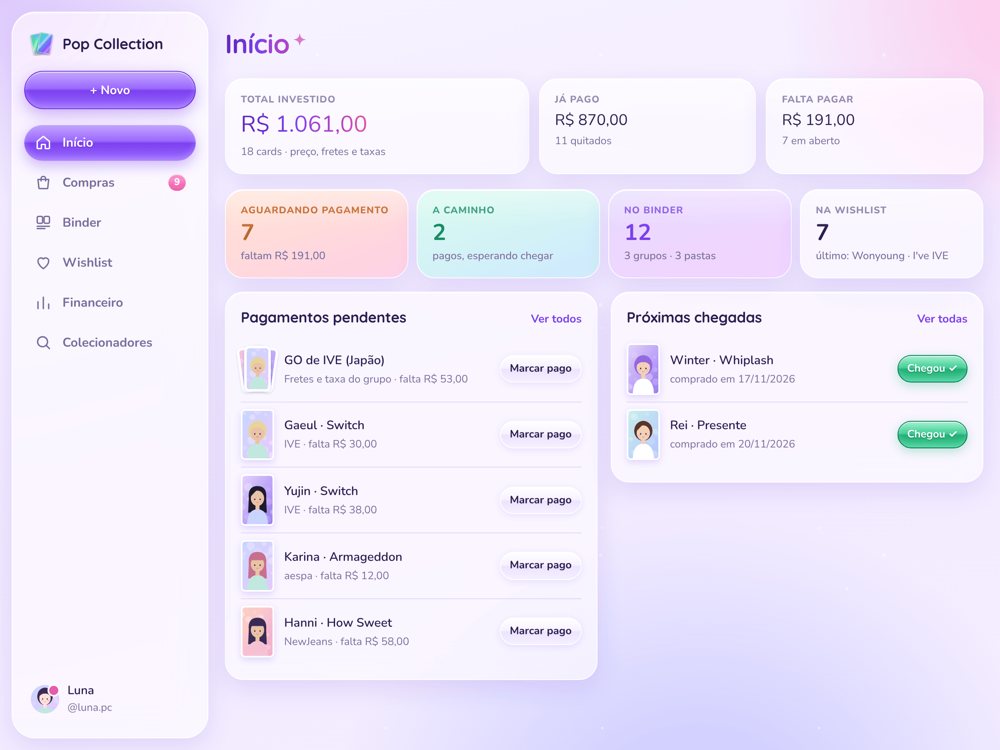
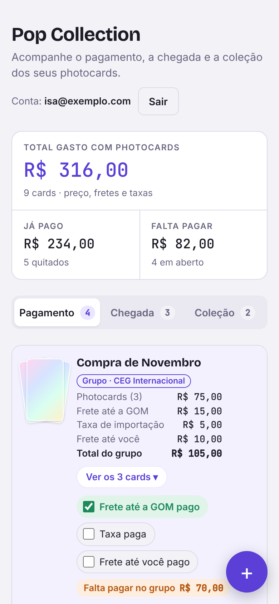
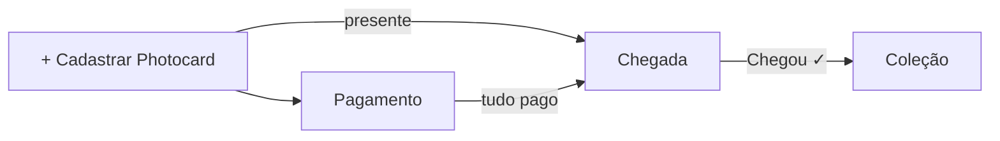
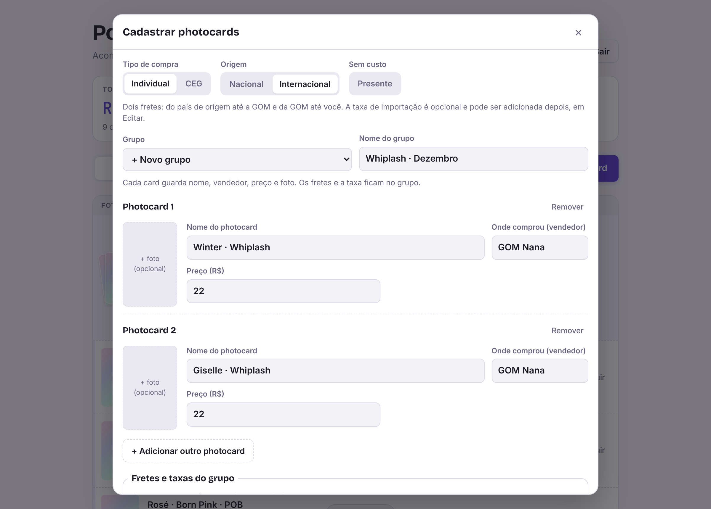
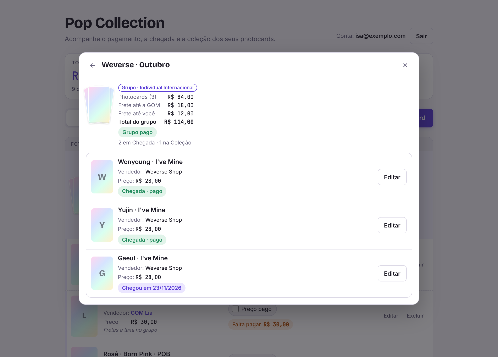
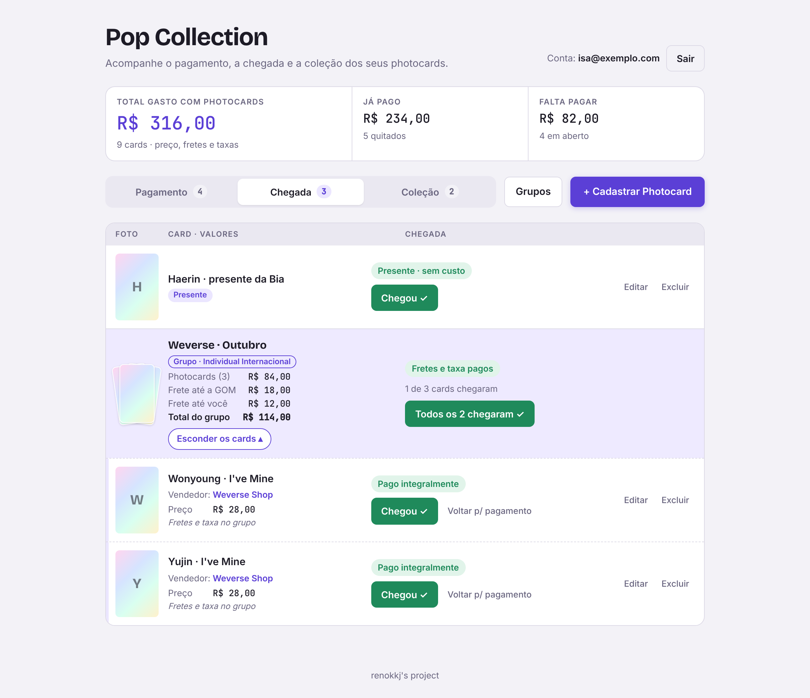
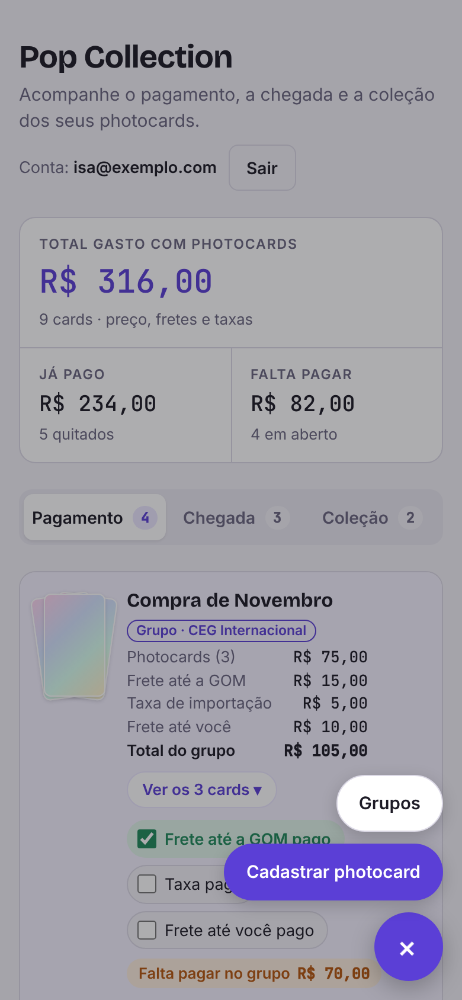

<div align="center">


# Pop Collection

Controle os pagamentos, a chegada e a coleção dos seus photocards.

[](https://renokkj.github.io/pop-collection/)


<br>

&nbsp;


<sub>Telas com dados de teste.</sub>

</div>

## Sobre o projeto

Criei o Pop Collection para resolver um problema meu: acompanhar quanto já paguei, o que falta pagar e quais photocards ainda estão a caminho. Foi o primeiro projeto que idealizei do zero, da ideia ao app publicado.

## O que o app faz

- **Contas individuais:** cada pessoa só vê os próprios cards.
- **Cadastro com foto:** pelo botão "+ Cadastrar Photocard", que abre uma janela com nome, vendedor, categoria, preço e fretes. A foto e o vendedor são opcionais. Dá para cadastrar vários cards de uma vez com "+ Adicionar outro photocard".
- **Categorias de compra:** Individual ou CEG, Nacional ou Internacional. O formulário mostra só os fretes e a taxa de importação (opcional) de cada categoria. Na CEG, você informa só a sua parte do que é dividido.
- **Presente:** marque "Presente" no cadastro para um card que você ganhou. Ele não tem custo nenhum e vai direto para a aba Chegada. Também pode entrar num grupo, sem mudar os fretes dele.
- **Grupos de compra:** junte cards da mesma compra num grupo com nome. Os fretes e a taxa de importação ficam no grupo e contam uma vez só, não importa quantos cards ele tenha. Nas abas, o grupo aparece como um bloco com os valores; clique nele para ver os cards.
- **Janela Grupos:** pelo botão "Grupos", "Ver" mostra os valores do grupo e a situação de cada card, e "Editar" cria grupos com cards já cadastrados, adiciona ou tira cards, renomeia e exclui o grupo (os cards continuam cadastrados).
- **Edição e exclusão:** corrija nome, vendedor, categoria, valores ou foto depois do cadastro, ou exclua um card.
- **Controle financeiro:** mostra o total gasto, o que já foi pago e o que falta pagar.
- **Três abas:** Pagamento, Chegada e Coleção, cada uma com a contagem de cards.
- **Chegada:** separa os cards quitados (e os presentes) que ainda estão a caminho.
- **Feito para o celular:** no celular, o botão + no canto da tela abre "Cadastrar photocard" e "Grupos".
- **Recuperar a senha** pelo link "Esqueci minha senha".
- **Tema claro e escuro**, conforme o dispositivo.

## Como funciona

O app abre nas abas **Pagamento**, **Chegada** e **Coleção**. O cadastro fica no botão **+ Cadastrar Photocard** e os grupos no botão **Grupos**, ao lado das abas. No celular, os dois ficam no botão **+** no canto da tela.



1. **Cadastrar:** clique em "+ Cadastrar Photocard", escolha a categoria e preencha os dados do card. O total (preço, fretes e taxa) é calculado sozinho, e o card entra na aba Pagamento. Para vários cards da mesma compra, use "+ Adicionar outro photocard" e dê um nome ao grupo. Se marcar "Presente", o card vai direto para a Chegada.
2. **Pagamento:** marque cada valor pago (preço, fretes e taxa). O app mostra quanto ainda falta. Num grupo, cada card tem o seu "Preço pago" e os fretes e a taxa são marcados uma vez só, no bloco do grupo. Clique no grupo para ver os cards dele.
3. **Chegada:** com tudo pago, o card vem para cá. Quando receber, clique em "Chegou ✓" (ou em "Todos chegaram ✓" no grupo). Se marcou algo errado, "Voltar p/ pagamento" desfaz.
4. **Coleção:** guarda os cards recebidos, um por um ou organizados por grupo ("Ainda não chegou" devolve o card para a Chegada). "Apagar coleção" remove esses cards e suas fotos, mas mantém o valor no total gasto.

## Telas

<table>
  <tr>
    <td width="50%"><br><sub><b>Cadastro:</b> vários cards de uma vez, num grupo com nome, ou como presente.</sub></td>
    <td width="50%"><br><sub><b>Grupos → Ver:</b> valores do grupo e a situação de cada card.</sub></td>
  </tr>
  <tr>
    <td width="50%"><br><sub><b>Chegada:</b> presente sem custo e grupo com "Todos chegaram".</sub></td>
    <td width="50%" align="center"><br><sub><b>Celular:</b> o botão + abre "Cadastrar photocard" e "Grupos".</sub></td>
  </tr>
</table>

<sub>Telas com dados de teste.</sub>

## Tecnologias

| Parte | Tecnologia |
| --- | --- |
| Site | HTML, CSS e JavaScript puros, sem etapa de build |
| Hospedagem | GitHub Pages (branch `main`, pasta `/ (root)`) |
| Contas, banco e fotos | [Supabase](https://supabase.com), na região São Paulo |

## Segurança

- As regras de acesso (RLS) do [`schema.sql`](supabase/schema.sql) limitam cada pessoa aos próprios dados.
- O bucket de fotos é privado, e as fotos são exibidas por links temporários.
- A chave `anon` do [`config.js`](config.js) pode ser pública. **Nunca** coloque a `service_role` no repositório.

## Arquivos

| Arquivo | O que faz |
| --- | --- |
| [`index.html`](index.html) | Telas de login e do app, e as janelas de cadastro de photocards e de grupos |
| [`style.css`](style.css) | Visual (temas claro e escuro) |
| [`app.js`](app.js) | Contas, cards, grupos, fotos e totais |
| [`config.js`](config.js) | URL e chave `anon` do Supabase |
| [`icons/`](icons) e [`manifest.webmanifest`](manifest.webmanifest) | Logo, ícone da aba e ícone para instalar o site como app |
| [`supabase/schema.sql`](supabase/schema.sql) | Tabelas, regras de segurança e bucket de fotos |

## Rodar no computador

```bash
git clone https://github.com/renokkj/pop-collection.git
cd pop-collection
python3 -m http.server 8000
```

Depois, abra http://localhost:8000.
