<div align="center">


# Pop Collection

Controle as compras, os pagamentos e a chegada dos seus photocards, monte o Binder e a Wishlist e siga outros colecionadores.

[](https://renokkj.github.io/pop-collection/)


<br>

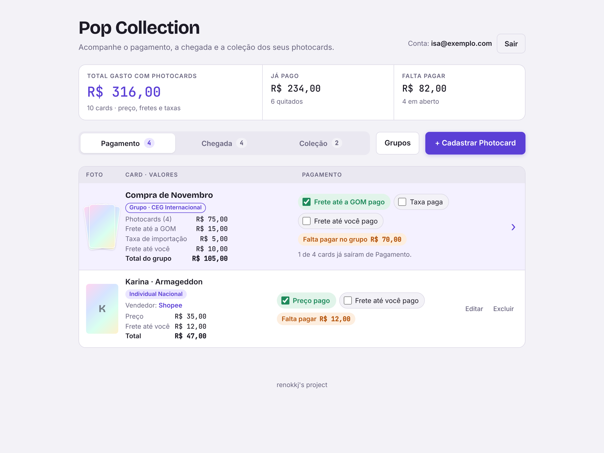&nbsp;
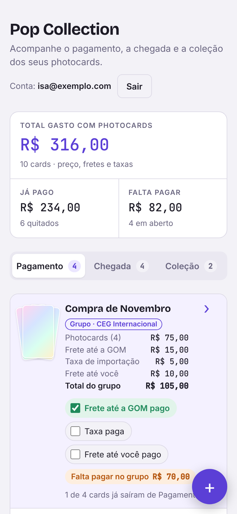

<sub>Telas com dados de exemplo.</sub>

</div>

## Sobre o projeto

Criei o Pop Collection para resolver um problema meu: acompanhar quanto já paguei, o que falta pagar e quais photocards ainda estão a caminho. Depois ele virou também o lugar da minha coleção (o Binder) e dos cards que eu quero ter (a Wishlist), e ganhou perfis para ver a coleção de outras pessoas e seguir quem coleciona os mesmos grupos. Foi o primeiro projeto que idealizei do zero, da ideia ao app publicado.

## O que o app faz

O app tem cinco seções: **Início**, **Compras**, **Binder**, **Wishlist** e **Financeiro**, além do seu **Perfil** e da busca de **Colecionadores**. No computador tudo fica na barra lateral; no celular, as seções ficam na barra de baixo, e a busca e o perfil, no topo.

### Compras

- **Registrar compra:** foto, nome, grupo de K-pop, vendedor, categoria, preço, fretes e data da compra. O total é calculado sozinho. Dá para registrar vários cards de uma vez com "+ Adicionar outro photocard".
- **Colar a foto:** no computador, copie uma imagem e aperte Ctrl+V (Cmd+V no Mac) no cadastro.
- **Categorias:** Individual ou CEG, Nacional ou Internacional. O formulário mostra só os fretes e a taxa de importação de cada categoria. Na CEG, você informa só a sua parte do que é dividido.
- **Presente:** um card que você ganhou não tem custo e vai direto para a Chegada.
- **Grupos:** os cards comprados juntos ficam num grupo, e os fretes e a taxa contam uma vez só. Registrar dois ou mais cards de uma vez cria o grupo sozinho. Na página do grupo dá para registrar um card comprado depois, trazer um card já cadastrado, tirar um card do grupo e editar o nome, a categoria e os fretes.
- **Três etapas:** Pagamento (falta pagar), Chegada (pago, a caminho) e Concluídas (já chegou). Cada etapa explica o que fazer nela, e a compra passa sozinha para a próxima.
- **Busca e filtros** por nome, artista ("Todos os artistas") e categoria.

### Binder

- **A coleção em grade, só com as fotos.** Toda compra que chega entra no Binder sozinha.
- **Adicionar ao Binder:** para os cards que você já tem, com foto, nome e grupo, sem valores.
- **Pastas** com nome e capa. Excluir uma pasta não apaga os cards.
- **Detalhes ao tocar na foto:** uma compra mostra vendedor, valores, pagamento e chegada; um card do Binder mostra grupo e data. Dá para mover de pasta, editar e excluir.
- **Excluir uma compra pelo Binder** pergunta se é para tirar só do Binder (a compra continua em Concluídas) ou excluir o card e a compra.
- **Selecionar** vários cards para mover de pasta ou definir o grupo de uma vez.

### Wishlist

- **Os cards que você quer ter**, com foto, nome, grupo e pastas próprias.
- **Adquiri este photocard:** "Comprei" abre o cadastro de compra já preenchido, e o card entra em Pagamento; "Já está comigo" leva o card direto para o Binder. O card não é duplicado.

### Início e Financeiro

- **Início:** total investido, já pago e falta pagar; quantos cards aguardam pagamento, estão a caminho, estão no Binder e na Wishlist; pagamentos pendentes com "Marcar pago"; próximas chegadas com "Chegou ✓".
- **Financeiro:** quanto foi em photocards, fretes e taxas; gasto dos últimos 12 meses em colunas; gasto por mês e por categoria. Só as compras entram nos valores.

### Comunidade

- **Perfil:** foto, nome, @username e até 5 grupos favoritos, com o Binder e a Wishlist em carrossel. Cada um pode ficar visível para todos ou só para você.
- **Colecionadores:** busque pessoas por @username, nome ou grupo favorito (ex.: aespa) e veja o Binder e a Wishlist delas.
- **Seguir:** siga outros colecionadores e veja as listas de seguidores e seguindo de cada perfil.
- **Avisos:** quando alguém começa a seguir você, aparece um aviso no perfil, com o botão "Seguir de volta".
- Valores, pagamentos e compras em andamento nunca aparecem para outras pessoas.

### Para todo o app

- **Contas individuais:** seus cards, valores e compras só você edita e vê; os outros veem apenas o que você deixar visível no perfil.
- **Botão + no celular:** em Compras, no Binder e na Wishlist ele abre o cadastro da seção; nas outras telas, mostra as opções. No computador, o mesmo fica no "+ Novo".
- **Recuperar a senha** pelo link "Esqueci minha senha".
- **Visual Y2K em roxo**, com vidro, brilho e molduras nos photocards.
- **Tema claro e escuro**, conforme o dispositivo.
- **Instalar como app:** no celular ou no computador, adicione o site à tela inicial.

## Como funciona

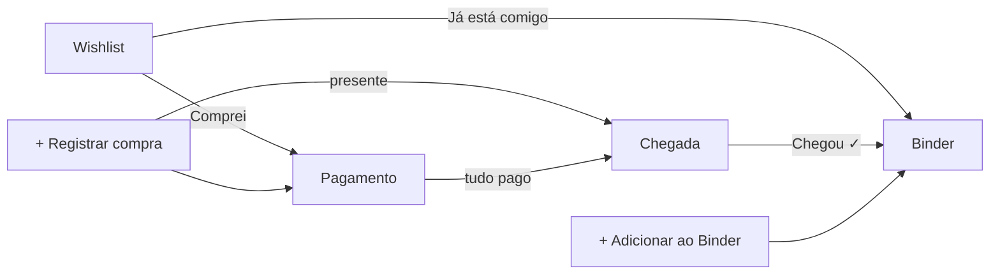

1. **Registrar:** a compra entra em Pagamento (ou direto na Chegada, se for presente).
2. **Pagamento:** marque cada valor pago. Num grupo, os fretes e a taxa são marcados uma vez só, no próprio grupo.
3. **Chegada:** com tudo pago, o card espera aqui até você tocar em "Chegou ✓".
4. **Binder:** o card que chegou aparece na grade, e a compra fica em Concluídas com os valores.
5. **Wishlist:** quando conseguir um card desejado, toque em "Adquiri este photocard".

## Telas

<table>
  <tr>
    <td width="50%">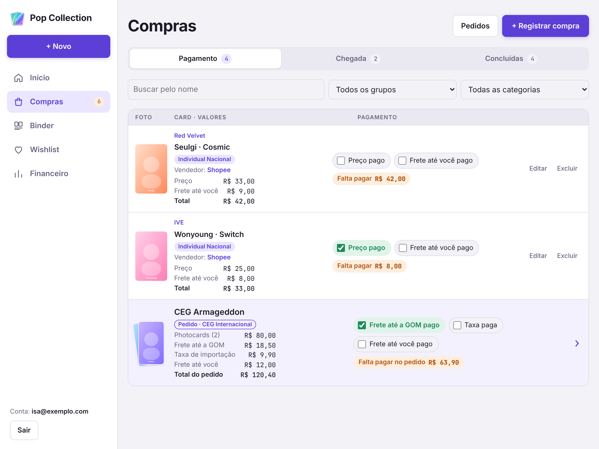<br><sub><b>Compras:</b> as etapas Pagamento, Chegada e Concluídas, com busca e filtros.</sub></td>
    <td width="50%">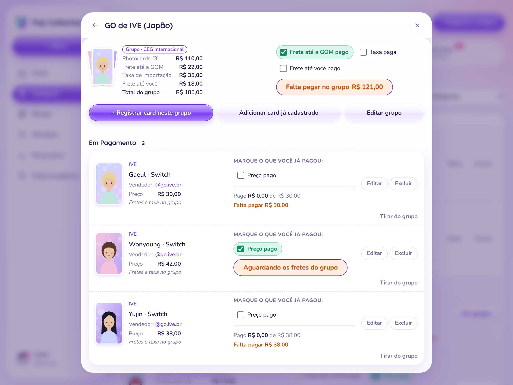<br><sub><b>Grupo:</b> fretes e taxa uma vez só, registrar ou trazer cards e tirar do grupo.</sub></td>
  </tr>
  <tr>
    <td width="50%">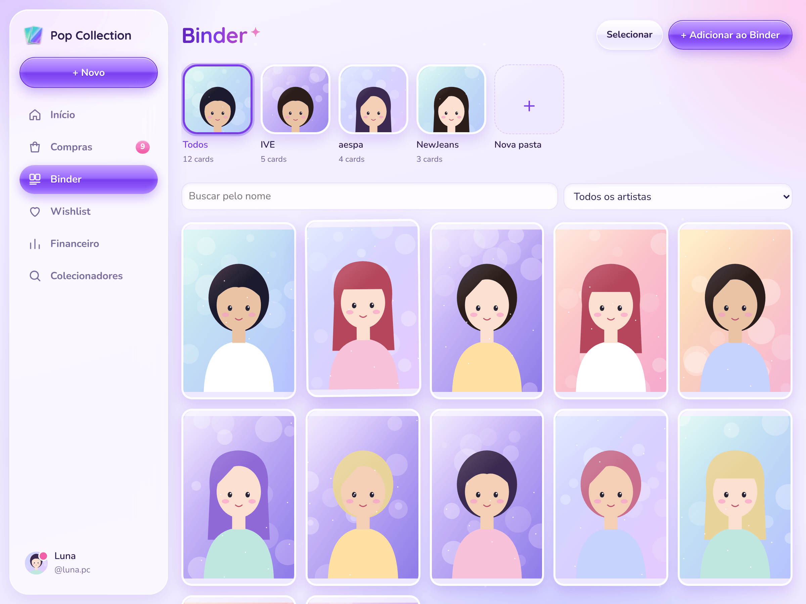<br><sub><b>Binder:</b> pastas no topo, busca, filtro por artista e a grade só com as fotos.</sub></td>
    <td width="50%">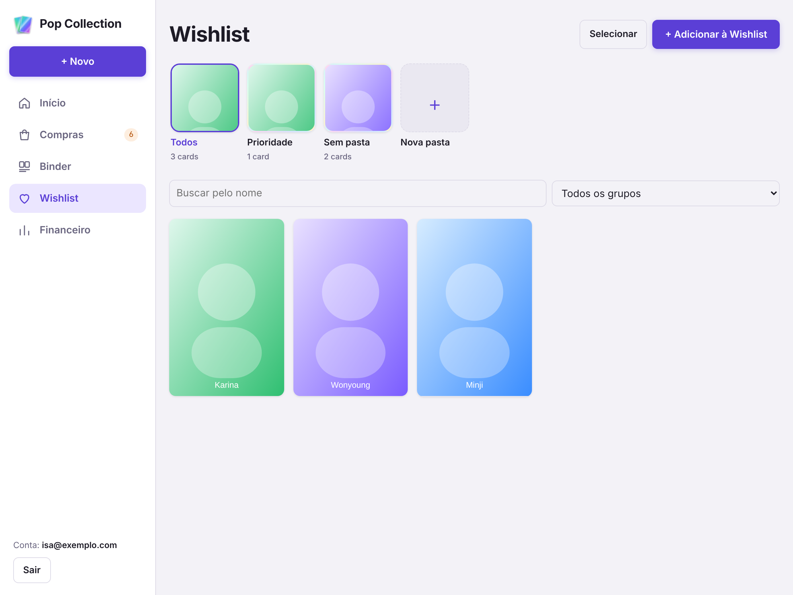<br><sub><b>Wishlist:</b> os cards que você quer ter, com pastas próprias.</sub></td>
  </tr>
  <tr>
    <td width="50%">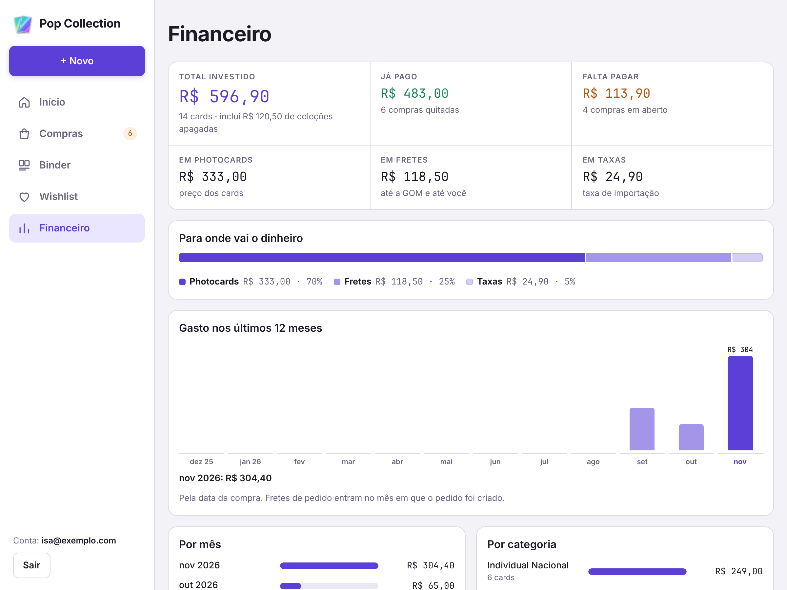<br><sub><b>Financeiro:</b> para onde vai o dinheiro e o gasto dos últimos 12 meses.</sub></td>
    <td width="50%">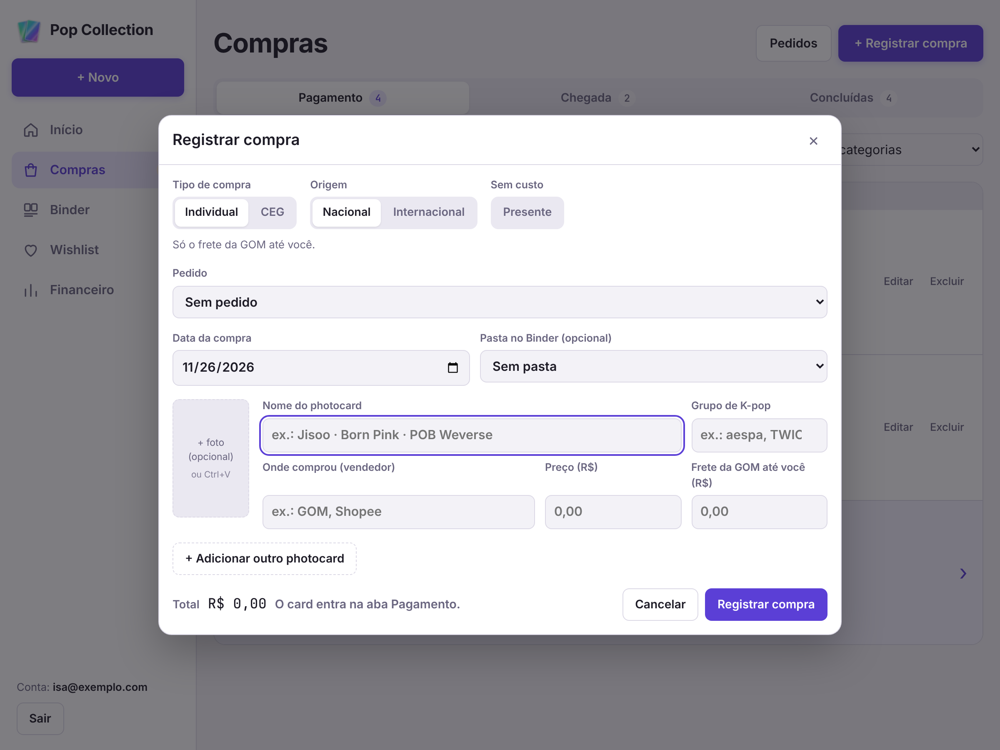<br><sub><b>Registrar compra:</b> categoria, grupo, data da compra, pasta no Binder e os dados de cada card.</sub></td>
  </tr>
  <tr>
    <td width="50%">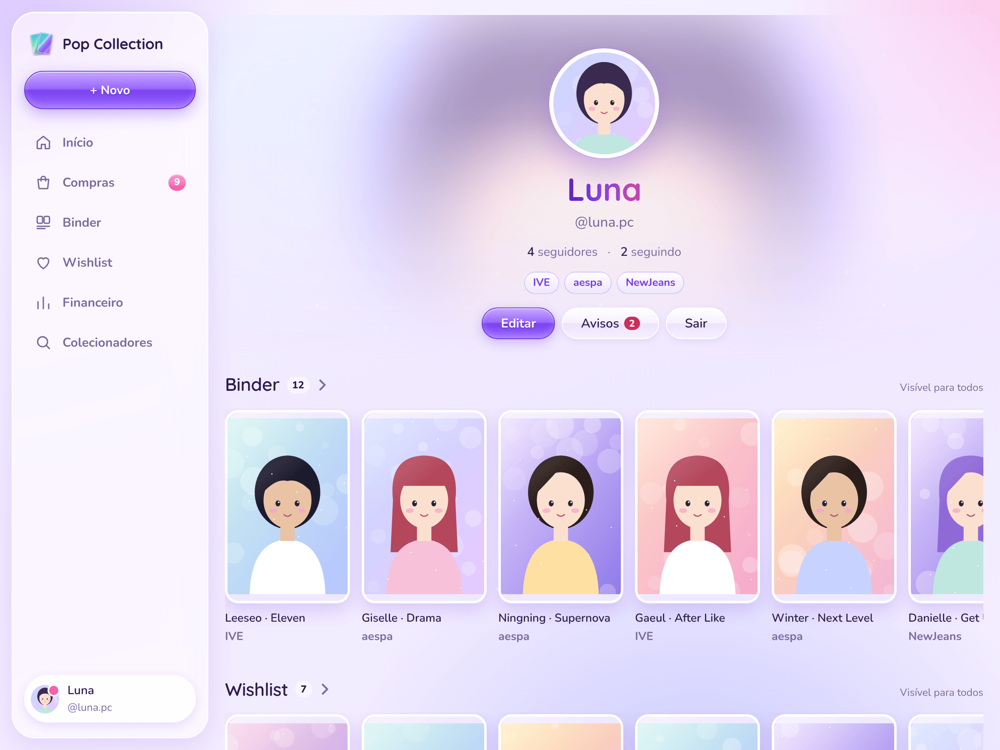<br><sub><b>Perfil:</b> foto, @username, seguidores, grupos favoritos e o Binder e a Wishlist em carrossel.</sub></td>
    <td width="50%">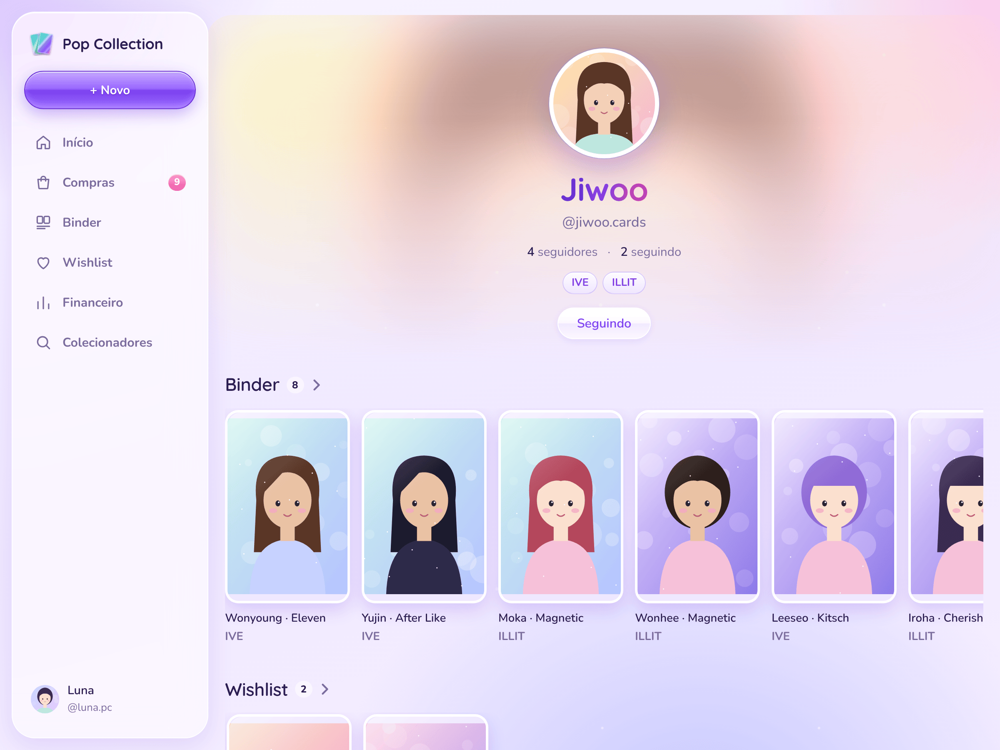<br><sub><b>Perfil de outra pessoa:</b> o Binder e a Wishlist que ela deixou visíveis, e o botão Seguir.</sub></td>
  </tr>
  <tr>
    <td width="50%">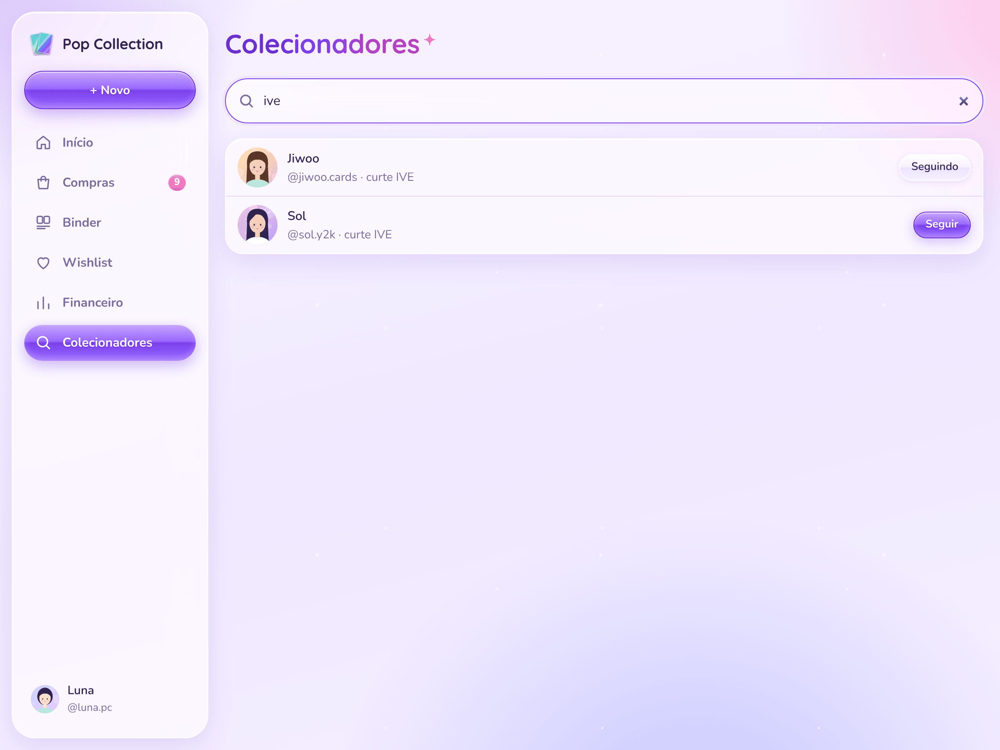<br><sub><b>Colecionadores:</b> busca por @username, nome ou grupo favorito.</sub></td>
    <td width="50%"><br><sub><b>Avisos:</b> quem começou a seguir você, com "Seguir de volta".</sub></td>
  </tr>
  <tr>
    <td colspan="2" align="center">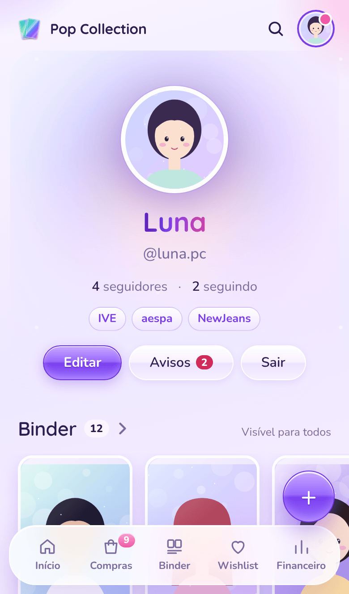&nbsp;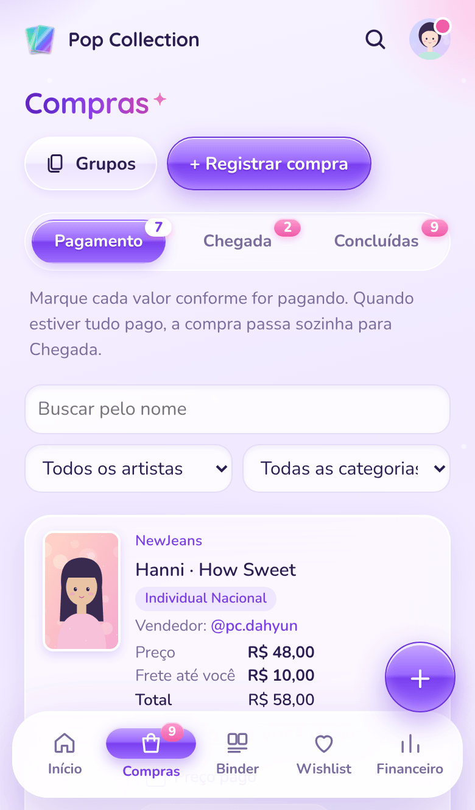&nbsp;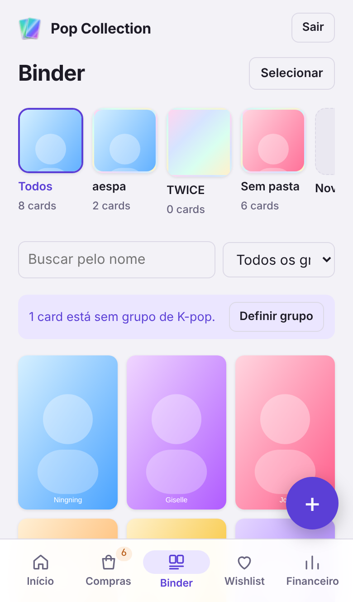&nbsp;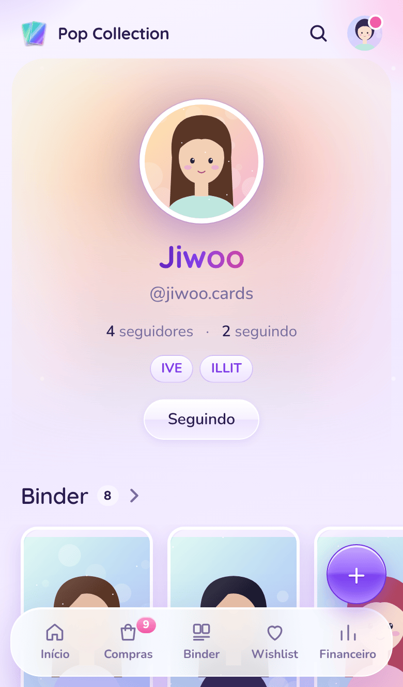<br><sub><b>Celular:</b> o perfil, Compras, o Binder e o perfil de outra pessoa.</sub></td>
  </tr>
  <tr>
    <td colspan="2" align="center">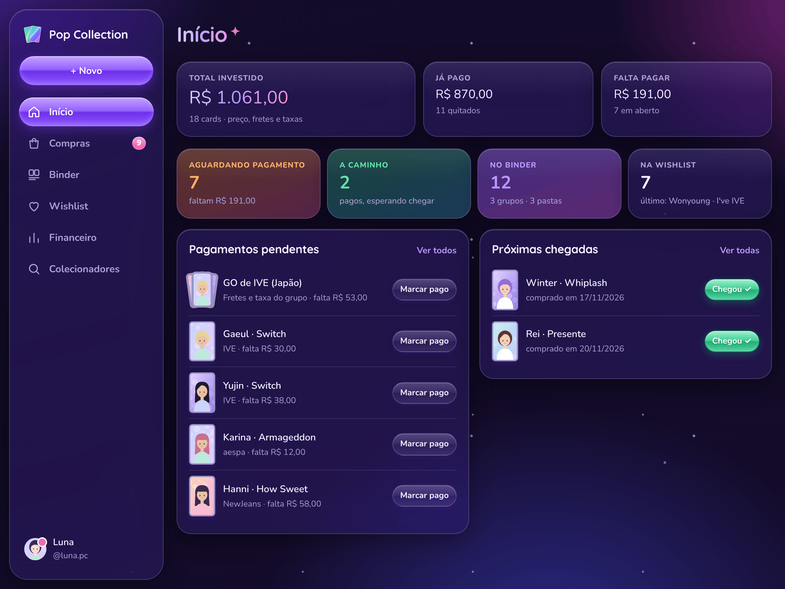<br><sub><b>Tema escuro:</b> segue o tema do dispositivo.</sub></td>
  </tr>
</table>

<sub>Telas com dados de exemplo.</sub>

## Tecnologias

| Parte | Tecnologia |
| --- | --- |
| Site | HTML, CSS e JavaScript puros, sem etapa de build; fontes Quicksand e Nunito (Google Fonts) |
| Hospedagem | GitHub Pages (branch `main`, pasta `/ (root)`) |
| Contas, banco e fotos | [Supabase](https://supabase.com), na região São Paulo |

## Banco de dados

O banco fica no Supabase (PostgreSQL). Tudo está em [`supabase/schema.sql`](supabase/schema.sql), que pode ser rodado de novo sem apagar dados.

| Tabela | O que guarda |
| --- | --- |
| `cards` | Cada photocard. A coluna `kind` diz o tipo: `compra`, `binder` ou `wishlist`. Compras têm valores, pagamento e chegada; Binder e Wishlist só têm foto, nome e grupo (uma regra do banco impede valores neles). |
| `card_groups` | Os grupos, com os fretes e a taxa que valem para vários cards |
| `folders` | As pastas do Binder e da Wishlist (`scope`) |
| `stats` | O valor das coleções apagadas em versões antigas, que continua no total |
| `profiles` | O perfil de cada pessoa: @username, nome, foto, grupos favoritos e quem pode ver o Binder e a Wishlist |
| `follows` | Quem segue quem |
| `notifications` | Os avisos de novos seguidores (os com mais de 90 dias são apagados) |

Os totais do app somam só os cards com `kind = 'compra'`.

## Segurança

- As regras de acesso (RLS) do [`schema.sql`](supabase/schema.sql) limitam cada pessoa aos próprios dados.
- Quem visita um perfil não lê a tabela `cards`: funções do banco devolvem só foto, nome, grupo e pasta dos cards visíveis, nunca valores.
- O bucket de fotos é privado, e as fotos são exibidas por links temporários.
- A chave `anon` do [`config.js`](config.js) pode ser pública. **Nunca** coloque a `service_role` no repositório.

## Arquivos

| Arquivo | O que faz |
| --- | --- |
| [`index.html`](index.html) | Telas de login e do app (Início, Compras, Binder, Wishlist, Financeiro, Perfil e Colecionadores) e as janelas de cadastro, grupos, pastas, detalhes, perfil e avisos |
| [`style.css`](style.css) | Visual Y2K em roxo, com vidro e brilho (temas claro e escuro) |
| [`app.js`](app.js) | Contas, compras, grupos, Binder, Wishlist, pastas, fotos, totais, gráficos, perfis, seguir e avisos |
| [`config.js`](config.js) | URL e chave `anon` do Supabase |
| [`icons/`](icons) e [`manifest.webmanifest`](manifest.webmanifest) | Logo, ícone da aba e ícone para instalar o site como app |
| [`supabase/schema.sql`](supabase/schema.sql) | Tabelas, regras de segurança e bucket de fotos (veja [Banco de dados](#banco-de-dados)) |

## Rodar no computador

```bash
git clone https://github.com/renokkj/pop-collection.git
cd pop-collection
python3 -m http.server 8000
```

Depois, abra http://localhost:8000.
