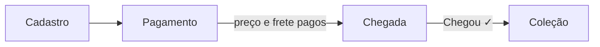

<div align="center">

# 🎴 Binder de Photocards

Controle os pagamentos, a chegada e a coleção dos seus photocards.

[](https://renokkj.github.io/PC-Collection/)


</div>

## ✨ O que o app faz

- 👤 **Contas individuais:** cada pessoa só vê os próprios cards.
- 📷 **Cadastro com foto:** nome, vendedor, preço e frete. A foto e o vendedor são opcionais.
- 💸 **Controle financeiro:** mostra o total gasto, o que já foi pago e o que falta pagar.
- 📦 **Chegada:** separa os cards quitados que ainda estão a caminho.
- 🌗 **Tema claro e escuro**, conforme o dispositivo.

## 🔄 Como funciona



1. **Cadastro:** preencha os dados do card. O total (preço + frete) é calculado sozinho.
2. **Pagamento:** marque "Preço pago" e "Frete pago". O app mostra quanto ainda falta.
3. **Chegada:** com tudo pago, o card vem para cá. Quando receber, clique em "Chegou ✓".
4. **Coleção:** guarda os cards recebidos. "Apagar coleção" remove esses cards e suas fotos, mas mantém o valor no total gasto.

## 🛠️ Tecnologias

| Parte | Tecnologia |
| --- | --- |
| Site | HTML, CSS e JavaScript puros, sem etapa de build |
| Hospedagem | GitHub Pages (branch `main`, pasta `/ (root)`) |
| Contas, banco e fotos | [Supabase](https://supabase.com), na região São Paulo |

## 🔒 Segurança

- As regras de acesso (RLS) do [`schema.sql`](supabase/schema.sql) limitam cada pessoa aos próprios dados.
- O bucket de fotos é privado, e as fotos são exibidas por links temporários.
- A chave `anon` do [`config.js`](config.js) pode ser pública. **Nunca** coloque a `service_role` no repositório.

## 📁 Arquivos

| Arquivo | O que faz |
| --- | --- |
| [`index.html`](index.html) | Telas de login, cadastro e do app |
| [`style.css`](style.css) | Visual (temas claro e escuro) |
| [`app.js`](app.js) | Contas, cards, fotos e totais |
| [`config.js`](config.js) | URL e chave `anon` do Supabase |
| [`supabase/schema.sql`](supabase/schema.sql) | Tabelas, regras de segurança e bucket de fotos |

## 💻 Rodar no computador

```bash
git clone https://github.com/renokkj/PC-Collection.git
cd PC-Collection
python3 -m http.server 8000
```

Depois, abra http://localhost:8000.

> O `config.js` deste repositório aponta para o banco do app publicado. Para testar com seus próprios dados, siga o passo a passo abaixo.

<details>
<summary><b>🚀 Publicar a sua própria versão</b></summary>

### 1. Criar o projeto no Supabase

1. Crie uma conta em https://supabase.com e clique em **New project**.
2. Abra **SQL Editor**, cole todo o conteúdo de [`supabase/schema.sql`](supabase/schema.sql) e clique em **Run**.
3. Em **Project Settings → API**, copie a **Project URL** e a chave **anon public**.
4. Substitua os dois valores no [`config.js`](config.js).

### 2. Publicar no GitHub Pages

1. Envie os arquivos para um repositório no GitHub.
2. Em **Settings → Pages**, escolha **Deploy from a branch**, a branch `main` e a pasta `/ (root)`.
3. Salve e espere o site ficar disponível em `https://SEU-USUARIO.github.io/NOME-DO-REPO/`.

### 3. Ajustar as URLs no Supabase

Em **Authentication → URL Configuration**, use o endereço do seu site em **Site URL** e adicione o mesmo endereço em **Redirect URLs**. Assim, os links dos e-mails voltam para o seu site.

### 4. Escolher a confirmação de e-mail

Por padrão, cada pessoa precisa confirmar o e-mail antes de entrar. Para desligar, desative **Confirm email** em **Authentication → Sign In / Providers → Email**.

O envio de e-mails do plano gratuito é limitado. Para muitos usuários, configure um SMTP próprio em **Authentication → Emails**.

</details>
